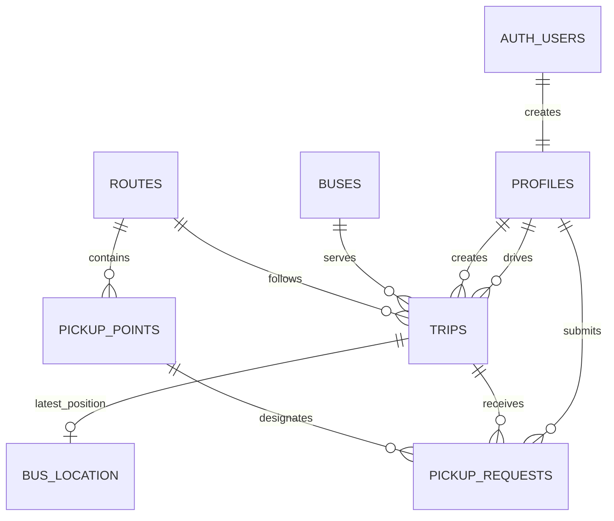

# Architecture and seven-table data dictionary

Browser → React Router pages → Supabase JS → Auth / Data API RPC / Realtime → PostgreSQL constraints and RLS.

Public data uses `public_feed()`, a fixed projection with no private identities. Direct trip/profile reads remain private. Public bus location reads are limited to active trips. No service-role key exists in client code. The `private` schema contains helper/trigger functions, with explicit execute grants; all security-definer functions fix their search path and qualify table names. Mutation RPCs validate the current database role, ownership, and lifecycle.

| Table             | Columns and constraints                                                                                                              | Cardinality / visibility                                                                                             |
| ----------------- | ------------------------------------------------------------------------------------------------------------------------------------ | -------------------------------------------------------------------------------------------------------------------- |
| `profiles`        | `id` UUID PK → Auth; first/last names 1–80 chars; `role` user/employee/admin; creation timestamp. One partial unique admin index.    | Auth 1:1; own profile, staff employee directory, or admin. Email stays in Auth.                                      |
| `buses`           | UUID PK; unique plate 1–30 chars; capacity 1–200; creation timestamp. Capacity reduction cannot invalidate counts.                   | 1:N trips; privacy-safe public read.                                                                                 |
| `routes`          | UUID PK; route name, origin, destination 1–160 chars.                                                                                | 1:N trips and stops; public read.                                                                                    |
| `pickup_points`   | UUID PK; non-null route FK; name; legal numeric(9,6) coordinates; nonnegative ordering; active flag.                                 | One route per stop record; public active stops; admin sees inactive.                                                 |
| `trips`           | UUID PK; bus/route FKs; nullable employee driver FK; creator FK; departure; nonnegative count; lifecycle status; creation timestamp. | At most one active trip per bus/employee. Full rows staff-only. Public projection omits driver/creator IDs.          |
| `bus_location`    | Trip UUID PK/FK; legal coordinates; server update timestamp; optional speed 0–200 km/h and accuracy.                                 | 0..1 latest row per trip; public only while active. No GPS history.                                                  |
| `pickup_requests` | UUID PK; trip/user/stop FKs; pending/accepted/rejected/cancelled/expired; request/response timestamps.                               | Own requests, assigned employee requests, or admin. Partial unique index blocks duplicate pending/accepted requests. |

FK deletion is restricted for operational records. Location cascades with trip deletion. Auth deletion cascades to its profile, but trip/request FKs may prevent deleting used profiles. The sole admin trigger blocks deletion and demotion. No manifests, seat numbers, employee types, or extra application tables exist.

| API                                             | Authorization / behavior                                                                                                                                                               |
| ----------------------------------------------- | -------------------------------------------------------------------------------------------------------------------------------------------------------------------------------------- |
| `public_feed()`                                 | Guest-safe routes, buses, active stops, current/next-30-day trips, active locations. No private identifiers.                                                                           |
| `manage_trip(id,data)`                          | Employee/admin schedule creation and editing. Active assignment locked; assigned employee/admin can end; finished records immutable. Starting requires the assigned employee or admin. |
| `adjust_passengers(trip,delta)`                 | Assigned active-trip employee, ±1 only, transactional lock, capacity trigger.                                                                                                          |
| `publish_location(trip,lat,lng,speed,accuracy)` | Assigned active-trip employee, latest location upsert with server time.                                                                                                                |
| `request_pickup(trip,point)`                    | Passenger only; active trip, active stop on same route, duplicate protection.                                                                                                          |
| `cancel_pickup(request)`                        | Owner of pending request only.                                                                                                                                                         |
| `respond_pickup(request,status)`                | Assigned active-trip employee, pending to accepted/rejected only; count unchanged.                                                                                                     |
| `set_employee_role(user,role)`                  | Admin only, user/employee only; sole admin protected; unfinished assignments block employee demotion.                                                                                  |
| `admin_save(entity,id,data)`                    | Admin CRUD for buses/routes/stops; existing profile names. Explicit entity allowlist and typed columns.                                                                                |
| `admin_delete(entity,id)`                       | Admin operational deletion; active trips and referenced rows protected. Auth deletion uses trusted dashboard.                                                                          |

The public feed polls every 15 seconds. Authenticated operations and request pages also subscribe to RLS-controlled changes, with polling fallback. Channels, intervals, and Geolocation watchers are cleaned up on navigation/logout. Public viewing never prompts for GPS. Locate me uses device coordinates only in browser state; no passenger location is sent to Supabase.

GPS writes run no faster than every 10 seconds, require movement over approximately 10 metres or a 30-second heartbeat, and reject accuracy over 100 metres in the client. Older-than-90-second positions use grey markers and an outdated warning. The server validates legal coordinates but cannot prove a client's physical position. Tracking requires HTTPS, permission, connectivity, and an active browser page.

Passenger delta locks the trip and validates against the bus row under a bus lock. Capacity edits and trip writes serialize through the bus row. Partial unique indexes prevent simultaneous active assignments. SQL transactions may fail on contention/deadlock and should be retried by an operator; no successful transaction may violate capacity.
